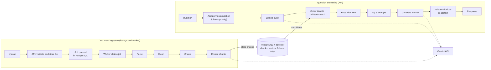
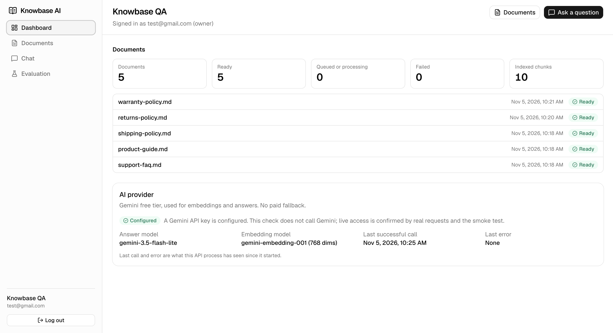
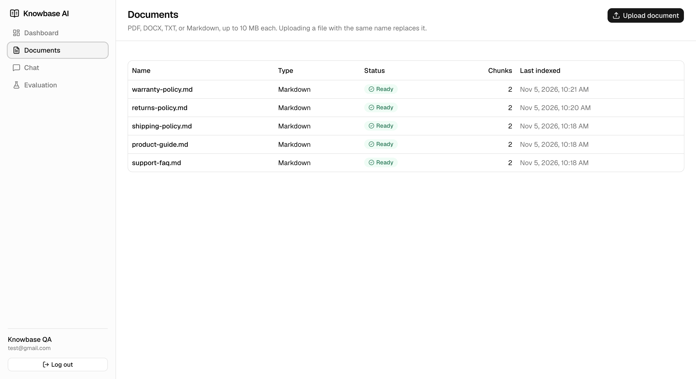
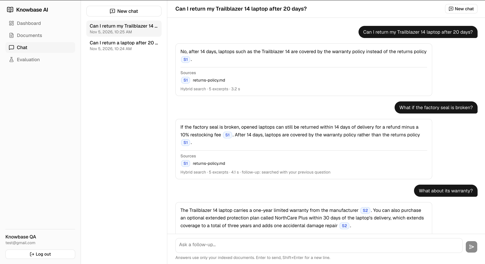
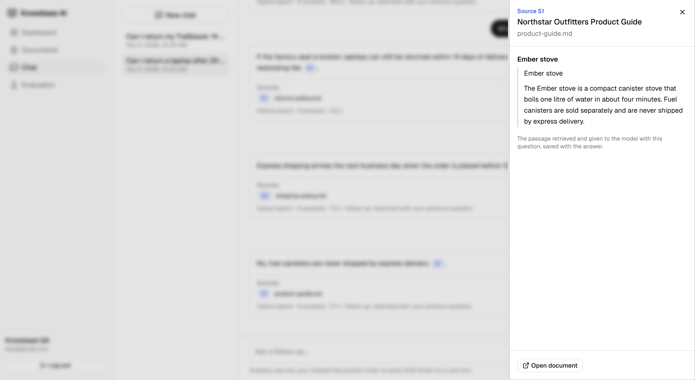
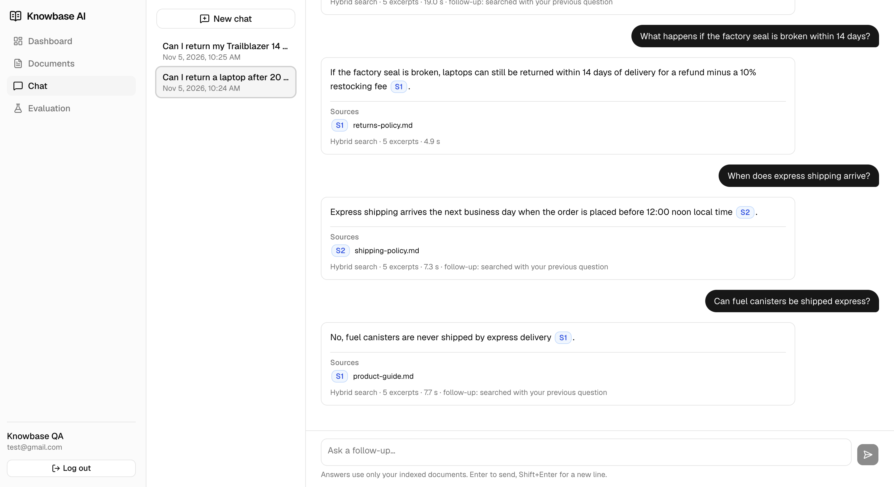
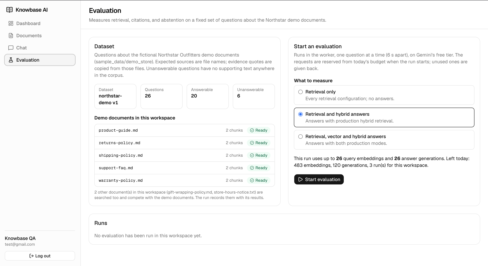

# Knowbase AI

## What is Knowbase?

Knowbase is a document-grounded knowledge assistant. You upload PDF, DOCX, TXT, or Markdown files to
a private workspace and ask questions about them. It uses retrieval-augmented generation (RAG): it
finds the relevant passages, asks Gemini to answer only from them, and shows the citations. When the
documents don't contain enough evidence, it says so instead of guessing.

General chatbots answer fluently whether or not they know. Knowbase requires answers to be traceable
to your documents, and a built-in evaluation measures how well that works. It is a locally runnable
prototype for learning and technical review, **not production software**.

## How does it work?



Uploads are processed in the background by a worker. Questions are answered while the user waits,
and each answer is checked before it is shown. Detailed diagrams:
[docs/architecture/overview.md](docs/architecture/overview.md).

## Screenshots

**Dashboard**



**Document management**



**Chat with citations**



**Cited source excerpt**



**Follow-up questions**



**Evaluation**



Screenshots of evaluation results are in [docs/screenshots/](docs/screenshots/).

## Technology Stack

| Layer | Technologies |
|---|---|
| Frontend | Next.js 16 (App Router), React 19, TypeScript, Tailwind CSS 4, shadcn/ui, TanStack Query |
| Backend | Python 3.12, FastAPI, Pydantic, SQLAlchemy 2.1, Alembic, PyJWT, Argon2 (pwdlib), pypdf, python-docx |
| Database and vectors | PostgreSQL 18, pgvector 0.8.7 (HNSW index), PostgreSQL full-text search (GIN index) |
| AI provider | Google Gemini via `google-genai`: `gemini-3.5-flash-lite` (answers), `gemini-embedding-001` at 768 dimensions |
| Background processing | A worker process and a job queue stored in PostgreSQL (no Redis or Celery) |
| Tooling | Docker Compose, GitHub Actions, uv, Ruff, mypy, pytest, ESLint, Vitest, Testing Library, Playwright |

## Backend Engineering Concepts

- **REST API with a service layer:** thin, versioned FastAPI routes call services. Errors share one
  JSON shape with a machine-readable code and never expose exception text or SQL.
- **Authentication:** Argon2 password hashing; signed JWT sessions in an HttpOnly, SameSite=Lax
  cookie; logout revokes the token on the server.
- **Workspace isolation:** the database session is bound to the caller's workspace and fails closed;
  queries also filter by workspace explicitly, and composite foreign keys stop cross-workspace
  references. Members have owner, admin, or member roles.
- **Schema and migrations:** check, unique, and composite-key constraints enforce rules in the
  database. Alembic migrations are tested, including that they match the SQLAlchemy models.
- **Durable background jobs:** workers claim job rows with `FOR UPDATE SKIP LOCKED`, renew a lease
  with a heartbeat, and write with a fencing token, so a stalled worker can't overwrite its
  successor. A crashed worker's jobs are recovered when its lease expires.
- **Failure handling:** temporary Gemini errors are retried with exponential backoff; permanent ones
  (such as a damaged PDF) fail once with a clear message. New chunks replace old ones in one
  transaction, so a failed re-index keeps the previous version searchable.
- **Untrusted files:** uploads are checked by type, file signature, and size. Parsing runs in a
  separate process with time and memory limits, plus page, character, and chunk limits.
- **Rate limits and budgets:** login and registration limits and daily Gemini budgets are counters
  in PostgreSQL, reserved before each call and given back when Gemini refuses it.
- **HTTP security:** CORS allows only the frontend; data-changing requests must send its `Origin`
  (CSRF protection); trusted-host and request-size checks.
- **Testing and CI:** unit tests, plus integration tests against real PostgreSQL with pgvector.
  GitHub Actions runs lint, type checks, migrations, tests, the frontend build, a bundle scan for
  API-key material, and a secrets check.

## AI and RAG Concepts

- **Chunking:** text is extracted, normalised, and split into overlapping, paragraph-aware chunks
  (about 1,800 characters). Embeddings are cached by content hash, so unchanged text is never
  embedded twice.
- **Task-specific embeddings:** documents use `RETRIEVAL_DOCUMENT` and questions `RETRIEVAL_QUERY`;
  vectors are validated and normalised to unit length.
- **Hybrid retrieval:** pgvector cosine search and PostgreSQL full-text search (`ts_rank_cd`,
  **not BM25**) each return 10 candidates. Reciprocal Rank Fusion combines their ranks, not raw
  scores (k = 60), and keeps the top 5. Production uses keyword AND with the `simple` configuration;
  OR matching and the `english` configuration are evaluation experiments only.
- **Follow-up questions:** a rule-based check (short questions, or words like "it" and "what about")
  adds the previous question to the search. No LLM classifier, no extra Gemini call.
- **Citation validation:** excerpts are numbered `[S1]`, `[S2]`, … The server keeps only ids it
  assigned, removes links not found in an excerpt, and withholds answers without a valid citation.
  This checks the cited documents, **not each individual claim**.
- **Abstention:** with no evidence, or when the model finds the excerpts insufficient, the user sees
  "not found" instead of an answer.
- **Prompt-injection protection:** excerpts, titles, and history are escaped and declared as data,
  not instructions. Tests confirm forged citations never survive validation; the model's own
  behaviour can't be guaranteed.
- **Provider failures:** Gemini errors and quota refusals are shown as errors, never as answers or
  abstentions. There is no paid fallback.
- **Evaluation:** a versioned dataset of 26 questions (20 answerable, 6 unanswerable) runs through the
  production retrieval and answer code, measuring HitRate@5, Recall@5, MRR, citation precision and
  recall, abstention accuracy, and latency.

### Evaluation results (one run, 4 November 2026)

Five demo documents (10 chunks); retrieval scored per source on the 20 answerable questions.

| Configuration | Recall@5 | MRR |
|---|---|---|
| Vector only | 0.975 | 0.917 |
| Hybrid, keyword AND (production) | 0.975 | 0.917 |
| Hybrid, keyword OR (experiment) | 1.000 | 1.000 |
| Hybrid, `english` AND (experiment) | 0.975 | 0.950 |
| Hybrid, `english` OR (experiment) | 1.000 | 0.975 |

- HitRate@5 was 1.00 everywhere, but random ranking already reaches 0.82 on 10 chunks.
- Production hybrid equalled vector-only: AND matching found no keyword match for 18 of 20 questions.
  OR helped on 4 questions but also matches stop-words, so the default is unchanged.
- Abstention accuracy was 1.00 in both answer modes and citation precision about 0.97. Four Gemini
  503/504 errors were recorded as provider errors, not abstentions.

Full report: [docs/evaluation/results-2026-11-04.md](docs/evaluation/results-2026-11-04.md).

## Weaknesses and Limitations

- **Small evaluation:** 26 questions, 10 chunks, one run. Answers vary between runs.
- **Keyword search rarely helps:** production AND matching seldom matches natural questions.
- **No relevance threshold:** answerable and unanswerable distances overlap, so abstention relies on
  the model and the citation check.
- **No claim-level verification:** answers can omit details that citation checks don't catch.
- **Gemini free tier:** median answer time about 15 s, up to a minute when busy; no streaming. All
  workspaces share one quota.
- **Scope:** no OCR (scanned PDFs fail), no URL ingestion, no password reset, MFA, or account deletion.
- **Operations:** one worker process, fixed-window rate limits, and local HTTP by default.

## Future Scope

Possible next steps, not implemented:

- A larger evaluation corpus with distractor documents, to test `english` OR matching.
- A calibrated relevance threshold, and claim-level checks or a labelled model judge.
- OCR and more document formats.
- URL ingestion, designed with SSRF protection.
- Streaming responses.
- Multiple workers, and a production deployment with HTTPS, monitoring, and account management.

## Getting Started

**Prerequisites:** Docker with Compose v2, and a Gemini API key from
[Google AI Studio](https://aistudio.google.com/) (optional: the app starts without one, but AI
features are unavailable). Don't enable billing, and use synthetic or public documents: free-tier
content may be used by Google.

```bash
cp .env.example .env
# Set APP_SECRET_KEY and JWT_SECRET to random values of at least 32 characters:
#   python3 -c "import secrets; print(secrets.token_urlsafe(48))"
# Optionally set GEMINI_API_KEY (backend only).

docker compose up --build -d
docker compose ps -a        # api and db healthy, migrate exited (0), worker up
```

Open **http://localhost:3000** (`localhost`, not `127.0.0.1`), register, and upload the files in
[sample_data/demo_store/](sample_data/demo_store/). API docs: http://localhost:8000/docs.

`docker compose down` keeps your data; `docker compose down -v` **deletes** the database and uploads.

## Further Documentation

- [Architecture overview](docs/architecture/overview.md)
- [Evaluation report](docs/evaluation/results-2026-11-04.md) and [raw export](docs/evaluation/run-2026-11-04.json)
- [Demo corpus](sample_data/README.md) and [prompt-injection test documents](backend/tests/fixtures/prompt_injection/README.md)
