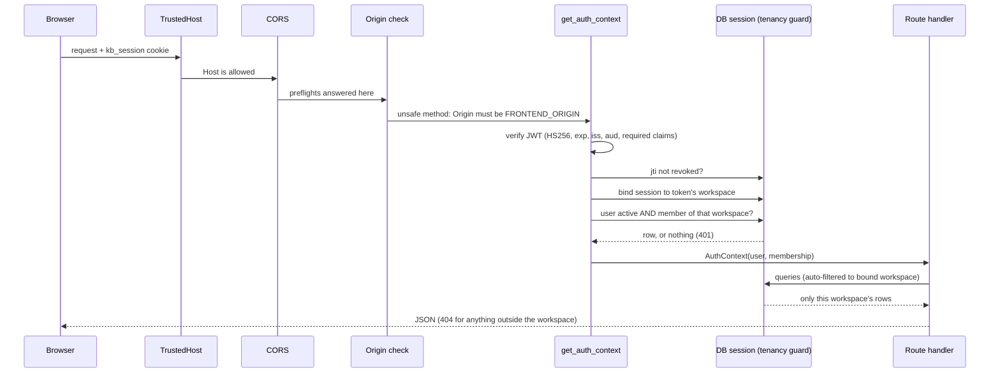
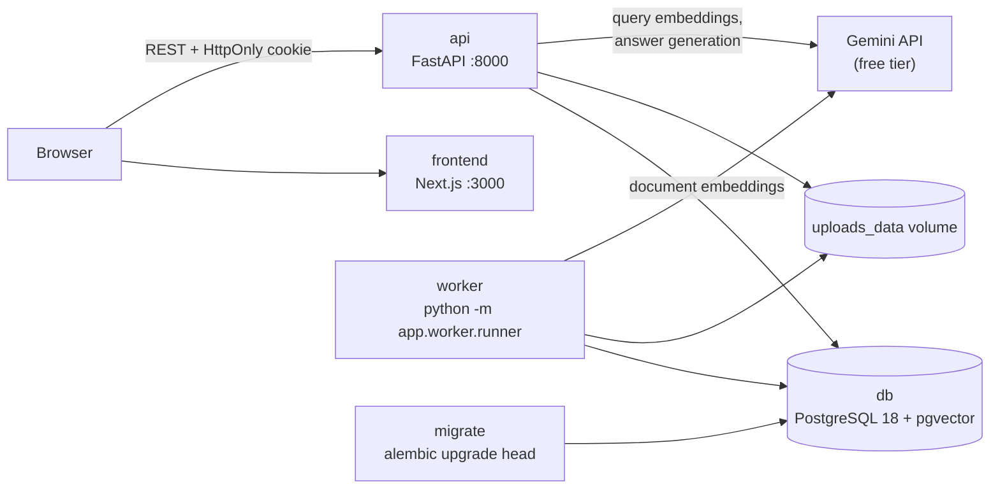
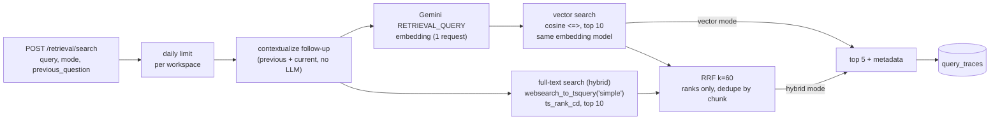
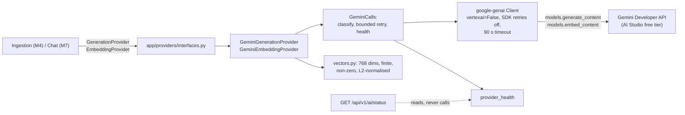

# Architecture overview

Status: design from [SPEC.md](../../SPEC.md) §4.

**Implemented (file-upload-only scope, [ADR 0008](../decisions/0008-file-upload-only-scope.md)):**
- `db`, `migrate`, `api`, and `worker` (no frontend yet).
- The api serves `/health`, `/ready`, `/api/v1/auth/*`, `/api/v1/workspaces/*`, `/api/v1/ai/status`, `/api/v1/sources*` (file sources), `/api/v1/jobs/{id}`, and `/api/v1/retrieval/*` (M6).
- Retrieval (M6): workspace-scoped pgvector search and PostgreSQL full-text search, fused with RRF, with a trace per search ("Retrieval" below).
- The worker processes file ingestion and deletion jobs from the PostgreSQL queue, dispatching by source kind (`file` is the only kind).
- Authentication and workspace isolation ("Request flow").
- The Gemini provider layer ("AI provider layer"). Ingestion uses it for document embeddings.
- File ingestion: upload → durable job → parse → clean → chunk → embed → pgvector ("File ingestion" below).
- Website crawling was built in M5 and removed by owner decision (M5 is descoped). The server never fetches user-supplied URLs.

**Planned:** chat (M7), frontend (M8), and evaluation (M9). See
[ADR 0003](../decisions/0003-m1-service-foundation.md) (M1),
[ADR 0004](../decisions/0004-m2-auth-and-tenancy.md) (M2),
[ADR 0005](../decisions/0005-m3-gemini-provider.md) (M3),
[ADR 0006](../decisions/0006-m4-file-ingestion.md) (M4),
[ADR 0007](../decisions/0007-m5-website-crawler.md) (M5, superseded), and
[ADR 0008](../decisions/0008-file-upload-only-scope.md) (file-upload-only scope), and
[ADR 0009](../decisions/0009-m6-hybrid-retrieval.md) (M6 retrieval), and
[ADR 0010](../decisions/0010-m0-m6-audit-remediation.md) (audit remediation).

## Request flow (authenticated API call)



Login sets the cookie. Logout records the token's `jti` in `revoked_tokens`
and clears it. Login and registration pass a PostgreSQL-backed rate limiter
first.

Knowbase AI runs locally as four long-running Docker Compose services plus a
one-shot migration job. All services share one PostgreSQL database; the API
and worker also share one upload volume.



## Service boundaries

| Service | Owns | Does not do |
|---|---|---|
| `frontend` | UI pages, calls to `/api/v1` with `credentials: "include"` | Hold any secret; call Gemini; compute metrics |
| `api` | Auth, workspace scoping, source CRUD, enqueueing jobs, retrieval, chat, citation validation, evaluation endpoints, health | Parsing or bulk embedding inside a request |
| `worker` | Claims `ingestion_jobs` with `FOR UPDATE SKIP LOCKED`; parses, cleans, chunks, embeds, and indexes files; stale-lock recovery; deletes | Serve HTTP; hold DB locks while calling Gemini |
| `db` | Relational data, `vector(768)` embeddings (HNSW), full-text `tsvector` (GIN), the job queue | Expose a public port (localhost-only if bound) |
| `migrate` | Applies Alembic migrations once, then exits | Run at request time |

## Networks and volumes (Compose)

| Name | Members | Purpose |
|---|---|---|
| `data` network (`internal: true`) | db, migrate, api, worker | Database traffic. No route to the internet |
| `egress` network | api, worker | Outbound calls to Gemini. Carries the API's port, published on `127.0.0.1` only |
| `postgres_data` volume | db, at `/var/lib/postgresql` (PG18 layout) | Database files. Kept by `docker compose down`, deleted by `down -v` |
| `uploads_data` volume | api and worker, both at `/app/data/uploads` | Uploaded files. A single shared location |

## File ingestion (M4)

```mermaid
sequenceDiagram
    participant B as Browser / client
    participant A as api
    participant V as uploads_data volume
    participant P as PostgreSQL
    participant W as worker
    participant G as Gemini (embeddings)
    B->>A: POST /sources/files (multipart, size-limited)
    A->>A: validate type, signature, UTF-8, name
    A->>V: write file under a UUID key (atomic)
    A->>P: upsert source + enqueue job (one transaction)
    A-->>B: 202 {source, job}   (no parsing, no Gemini)
    W->>P: claim job: FOR UPDATE SKIP LOCKED, new lock_token, commit
    W->>V: read file
    W->>W: parse in a child process (pypdf / python-docx / text; time, memory, page, and size limits) → clean → hash
    alt content unchanged
        W->>P: mark ready (0 embeddings)
    else changed or new
        W->>W: chunk (paragraph-aware)
        W->>P: look up embedding_cache
        W->>P: reserve daily budget (atomic)
        W->>G: embed uncached chunks (RETRIEVAL_DOCUMENT, 768, batches of 8)
        W->>P: cache vectors per batch
        W->>P: ONE transaction: replace chunks, mark source ready, finish job (token-fenced)
    end
    W-->>P: heartbeat every 30 s (lease 120 s)
```

| Concern | Mechanism |
|---|---|
| Two workers, one job | `FOR UPDATE SKIP LOCKED` claim, committed before slow work |
| Two jobs, one source | A source with a running job is not claimed; uploads, deletes, and the worker lock the source row first (then the job); a superseded job never publishes |
| Hostile document | Parsing in a killable child process (`PARSE_TIMEOUT_SECONDS`, `PARSE_MEMORY_LIMIT_MB`); page, text, and chunk limits checked while parsing; every job has a deadline (`JOB_MAX_RUNTIME_SECONDS`) |
| Worker crash | Lease lapses; recovery requeues the job (or fails it when out of attempts) |
| Stale worker wakes up | Fencing `lock_token` on every write; its publish and heartbeat are refused |
| Re-upload or reindex of unchanged content | Same hash, chunker, and model: no chunking, no Gemini calls |
| Changed content | Chunks rebuilt; unchanged chunk texts reuse cached vectors |
| Failed replacement | Old chunks untouched until a single publish transaction; any failure rolls back |
| Free-tier protection | Installation-wide daily text budget, reserved atomically and refunded when Gemini refuses a call; cached texts never count; quota and rate-limit waits don't use attempts |
| Tenant isolation | Composite `(workspace_id, …)` foreign keys plus the session guard; claim and recovery are the only explicit cross-workspace statements |

## Retrieval (M6)



| Concern | Mechanism |
|---|---|
| Cross-workspace results | Tenancy guard on the ORM statements **and** explicit `workspace_id` filters on chunks, documents, and sources; an unbound session fails closed |
| Mixing embedding models | Vector search compares only chunks with the configured `embedding_model` |
| Score scales | RRF combines ranks only; raw distances and `ts_rank_cd` are reported, never added |
| Filtered ANN under-returning | `hnsw.iterative_scan = strict_order` |
| Gemini cost | `DAILY_RETRIEVAL_REQUEST_LIMIT` (per workspace) and `DAILY_QUERY_EMBEDDING_LIMIT` (installation) reserved before the query embedding, and given back if Gemini refuses it; no DB connection held during the call; clear 429/503 on provider errors (ADR 0010) |
| Observability | One trace per search: candidates with ranks and raw scores, fused scores, settings, latency |

## AI provider layer (M3)



| Step | Generation | Document embedding | Query embedding |
|---|---|---|---|
| Model | `GEMINI_CHAT_MODEL` | `GEMINI_EMBEDDING_MODEL` | same as documents |
| Settings | thinking level, max output tokens | `RETRIEVAL_DOCUMENT`, 768 dims, batches of 8 | `RETRIEVAL_QUERY`, 768 dims |
| Result checks | finish reason `STOP` and non-empty text, else `IncompleteGeneration` | one vector per input; each 768, finite, non-zero; normalised | same |
| Retries | 429 rate limit, 500/502/503, connection errors: up to 3, exponential backoff with jitter | same | same |
| No retry | daily quota, 4xx, 504 deadline exceeded | same | same |

## Boundaries that matter for security and cost

- **Gemini key:** read only by `api` and `worker` from the backend `.env`.
  Never in a `NEXT_PUBLIC_*` variable, the browser bundle, or an API response.
- **Tenant isolation:** the API derives `workspace_id` from the authenticated
  user. Every workspace-owned table carries `workspace_id`, and composite
  foreign keys block cross-workspace references. Workspace-owned models
  inherit `WorkspaceScoped`; the session guard filters their ORM queries
  automatically and fails closed when no workspace is bound.
- **Untrusted inputs:** uploaded files and retrieved excerpts are data.
  Uploads are signature-checked and size-limited and never executed; the
  prompt treats excerpts as evidence, not instructions. The server never
  fetches user-supplied URLs.
- **No paid services:** no Redis/Celery, hosted vector DB, reranker, or
  billing fallback. When Gemini quota runs out, the user sees an error.

## RAG pipeline stages (explicit, no orchestration framework)

1. Ingest: parse the uploaded file, then clean, chunk, embed (`RETRIEVAL_DOCUMENT`, 768 dims, normalized), and store.
2. Retrieve: vector (`<=>` cosine) and lexical (`websearch_to_tsquery` + `ts_rank_cd`, not BM25).
3. Fuse: Reciprocal Rank Fusion with `k=60`, top 5.
4. Generate: Gemini answer from `[S#]`-keyed excerpts.
5. Validate: drop unknown citation IDs; abstain when there is no valid evidence.
6. Evaluate: compare vector-only and hybrid modes on the seeded dataset.
