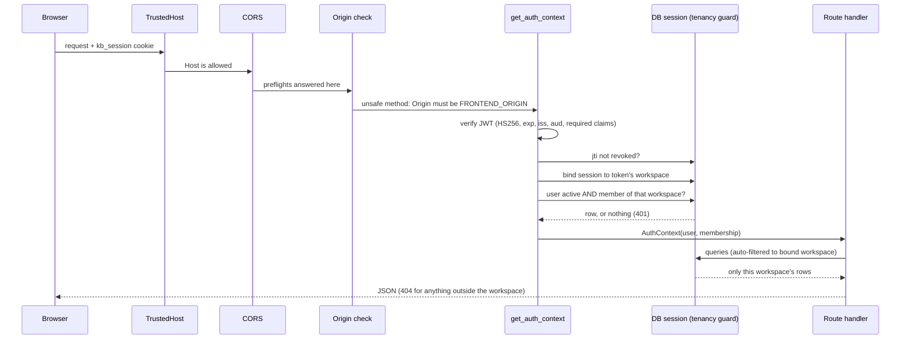
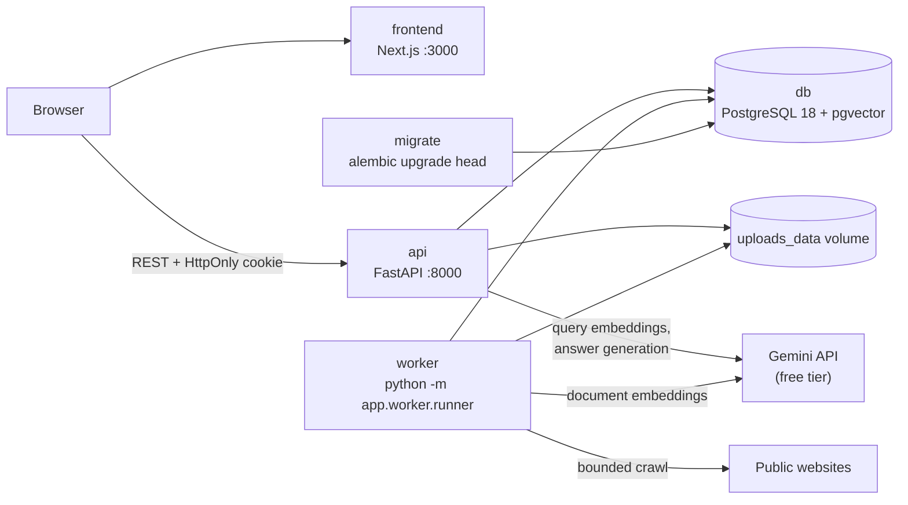

# Architecture overview

Status: design from [SPEC.md](../../SPEC.md) §4.

**Implemented as of Milestone 2:**
- `db`, `migrate`, and `api`. The api serves `/health`, `/ready`, `/api/v1/auth/*`, and `/api/v1/workspaces/*`.
- A `worker` placeholder that connects and idles.
- The two networks and the volumes described below.
- Authentication and workspace isolation, described in "Request flow" below.

Everything else on this page is planned. See
[ADR 0003](../decisions/0003-m1-service-foundation.md) (M1) and
[ADR 0004](../decisions/0004-m2-auth-and-tenancy.md) (M2).

## Request flow (authenticated API call)

Login sets the cookie. Logout records the token's `jti` in `revoked_tokens`
and clears it. Login and registration pass a PostgreSQL-backed rate limiter
first.

Knowbase AI runs locally as four long-running Docker Compose services plus a
one-shot migration job. All services share one PostgreSQL database; the API
and worker also share one upload volume.

## Service boundaries

| Service | Owns | Does not do |
|---|---|---|
| `frontend` | UI pages, calls to `/api/v1` with `credentials: "include"` | Hold any secret; call Gemini; compute metrics |
| `api` | Auth, workspace scoping, source CRUD, enqueueing jobs, retrieval, chat, citation validation, evaluation endpoints, health | Long crawls or bulk embedding inside a request |
| `worker` | Claims `ingestion_jobs` with `FOR UPDATE SKIP LOCKED`; crawls, parses, cleans, chunks, embeds, and indexes; stale-lock recovery | Serve HTTP |
| `db` | Relational data, `vector(768)` embeddings (HNSW), full-text `tsvector` (GIN), the job queue | Expose a public port (localhost-only if bound) |
| `migrate` | Applies Alembic migrations once, then exits | Run at request time |

## Networks and volumes (Compose)

| Name | Members | Purpose |
|---|---|---|
| `data` network (`internal: true`) | db, migrate, api, worker | Database traffic. No route to the internet |
| `egress` network | api, worker | Outbound calls to Gemini and, for the worker, public websites. Carries the API's port, published on `127.0.0.1` only |
| `postgres_data` volume | db, at `/var/lib/postgresql` (PG18 layout) | Database files. Kept by `docker compose down`, deleted by `down -v` |
| `uploads_data` volume | api and worker, both at `/app/data/uploads` | Uploaded files. A single shared location |

## Boundaries that matter for security and cost

- **Gemini key:** read only by `api` and `worker` from the backend `.env`.
  Never in a `NEXT_PUBLIC_*` variable, the browser bundle, or an API response.
- **Tenant isolation:** the API derives `workspace_id` from the authenticated
  user. Every workspace-owned table carries `workspace_id`, and composite
  foreign keys block cross-workspace references. Workspace-owned models
  inherit `WorkspaceScoped`; the session guard filters their ORM queries
  automatically and fails closed when no workspace is bound.
- **Untrusted inputs:** uploaded files, crawled HTML, and retrieved excerpts
  are data. The crawler enforces SSRF checks; the prompt treats excerpts as
  evidence, not instructions.
- **No paid services:** no Redis/Celery, hosted vector DB, reranker, or
  billing fallback. When Gemini quota runs out, the user sees an error.

## RAG pipeline stages (explicit, no orchestration framework)

1. Ingest: crawl or parse, then clean, chunk, embed (`RETRIEVAL_DOCUMENT`, 768 dims, normalized), and store.
2. Retrieve: vector (`<=>` cosine) and lexical (`websearch_to_tsquery` + `ts_rank_cd`, not BM25).
3. Fuse: Reciprocal Rank Fusion with `k=60`, top 5.
4. Generate: Gemini answer from `[S#]`-keyed excerpts.
5. Validate: drop unknown citation IDs; abstain when there is no valid evidence.
6. Evaluate: compare vector-only and hybrid modes on the seeded dataset.
